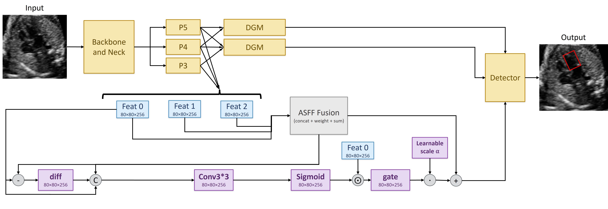
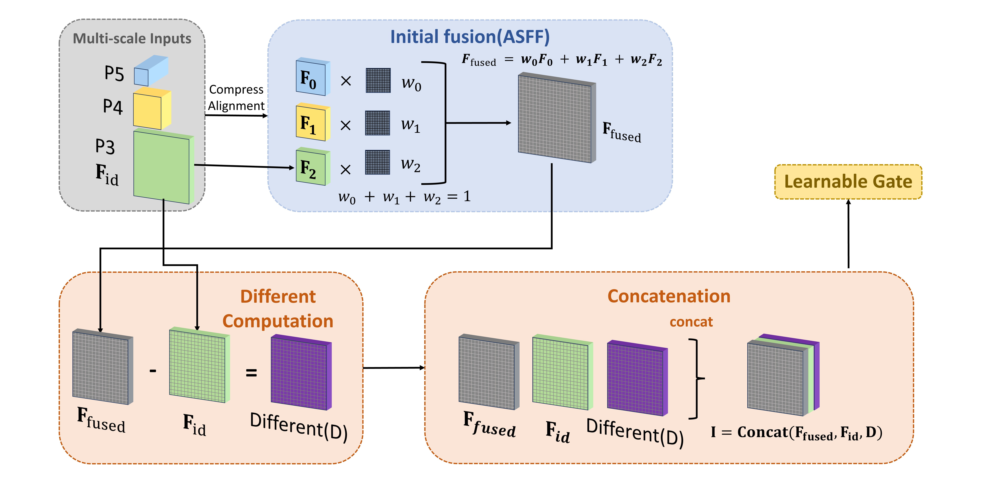
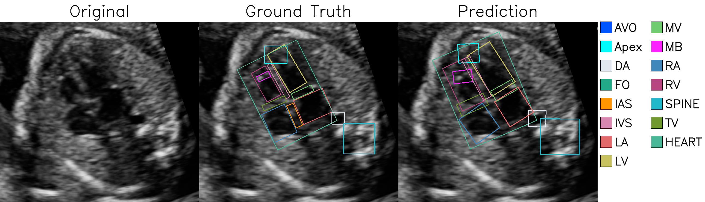
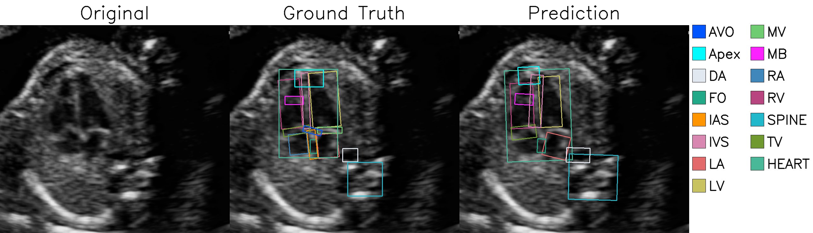
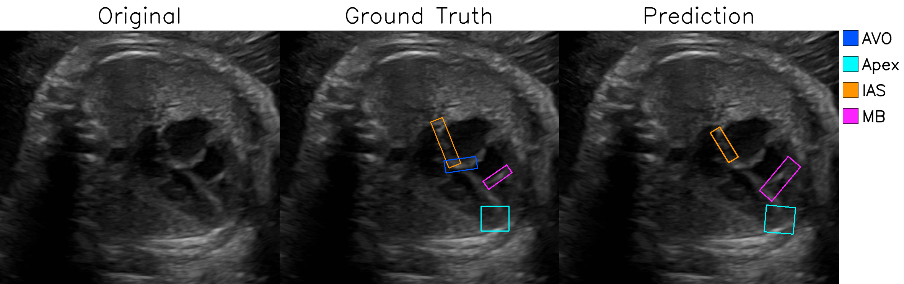
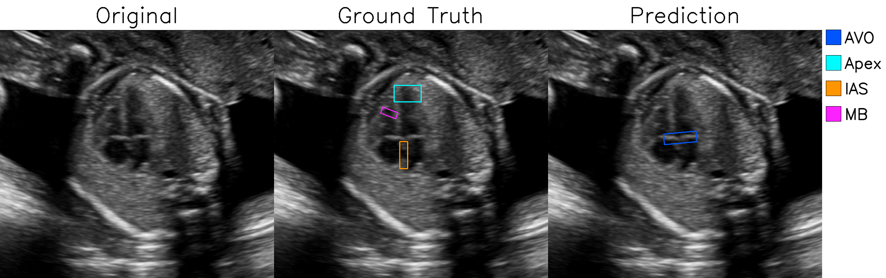
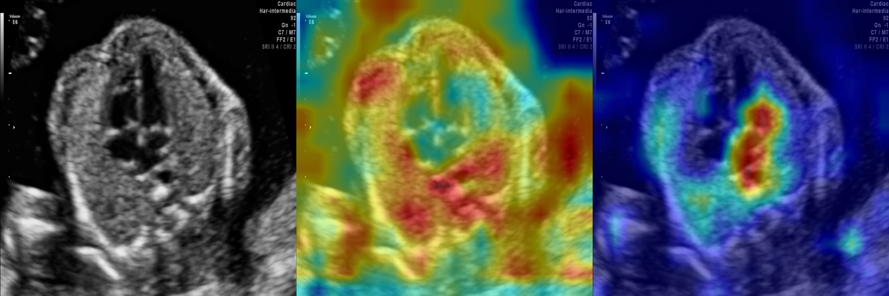

<!--
DGM project README.
Replace the remaining [TODO: ...] fields only after the details are confirmed.
Paper figures are placeholders; add only figures that are approved for public release.
-->

<div align="center">

  <h1>Difference-Guided Gating Method (DGM)</h1>
  <p><strong>High-Fidelity Fetal Heart Ultrasound Object Detection</strong></p>
  <p>A YOLOv8-based method for reducing fusion-induced feature degradation during multi-scale feature fusion.</p>
  <p>
    <a href="https://github.com/wenda-qi24/DGM-YOLOv8"></a>
    <a href="https://www.ultralytics.com/"></a>
    <a href="https://docs.ultralytics.com/quickstart/"></a>
  </p>

</div>

---

## Contents

<p align="center">
  <a href="#overview">Overview</a> ·
  <a href="#main-contributions">Contributions</a> ·
  <a href="#method">Method</a> ·
  <a href="#results">Results</a> ·
  <a href="#qualitative-results">Qualitative Results</a> ·
  <a href="#dataset">Dataset</a> ·
  <a href="#installation">Installation</a> ·
  <a href="#training">Training</a> ·
  <a href="#citation">Citation</a>
</p>

<details>
<summary><strong>Full section list</strong></summary>

- [Overview](#overview)
- [Main Contributions](#main-contributions)
- [Method](#method)
- [Results](#results)
- [Qualitative Results](#qualitative-results)
- [Dataset](#dataset)
- [Environment](#environment)
- [Installation](#installation)
- [Training](#training)
- [Evaluation and Inference](#evaluation-and-inference)
- [Repository Structure](#repository-structure)
- [Limitations](#limitations)
- [Citation](#citation)
- [License](#license)

</details>

---

## Overview

Fetal echocardiography is an important prenatal ultrasound modality, but detecting fetal cardiac anatomical structures remains challenging. Speckle noise, acoustic shadowing, signal dropout, blurred boundaries, and substantial scale variation can obscure anatomical details, particularly for small or structurally complex targets.

This work proposes **DGM (Difference-Guided Method)**, a YOLOv8-based detection framework that integrates a difference-aware mechanism and a learnable gate into the Adaptive Spatial Feature Fusion (ASFF) module.

> **Excerpt from the paper abstract**
>
> “In fetal echocardiography, cardiac anatomical structures exhibit unique, subtle morphological features that are challenging to detect. To address this issue, we developed DGM (Difference-Guided Method), a YOLOv8-based detection framework that, together with the Adaptive Spatial Feature Fusion (ASFF) module, is used for detecting fetal cardiac anatomical structures.”

The key idea is to compare the fused feature with the original feature at the corresponding scale. The resulting difference signal is provided to a learnable gate, which adaptively regulates the contribution of the original feature to the refined representation.

---

## Main Contributions

1. **Difference-aware mechanism.** DGM explicitly computes the element-wise difference between the ASFF-fused feature and the original feature at the corresponding level, making fusion-induced feature changes observable to the network.

2. **Learnable gated refinement.** The fused feature, identity feature, and difference feature are concatenated and processed by a lightweight convolutional gate to adaptively regulate the identity-feature contribution.

3. **Integration into YOLOv8.** The refinement mechanism is embedded in the three ASFF blocks in the YOLOv8 neck, corresponding to the P3/8, P4/16, and P5/32 feature levels.

---

## Method

### Overall Architecture

DGM retains ASFF-based multi-scale fusion and adds an identity-feature refinement branch guided by the difference between the fused and original representations.

<div align="center">
  
  <p><em>Overview of the Difference-Guided Method (DGM).</em></p>
</div>

### Difference-aware Mechanism and Learnable Gate

Let the fused representation be denoted by $F_{\mathrm{fused}}$ and the identity feature at the corresponding level by $F_{\mathrm{id}}$. DGM computes their element-wise difference:

$$
D = F_{\mathrm{fused}} - F_{\mathrm{id}}.
$$

The fused feature, identity feature, and difference feature are concatenated along the channel dimension:

$$
\begin{aligned}
I &= \mathrm{Concat}(F_{\mathrm{fused}}, F_{\mathrm{id}}, D), \\
G &= \sigma(\phi(I)).
\end{aligned}
$$

The output is computed as:

$$
F_{\mathrm{out}} = F_{\mathrm{fused}} + \alpha G \odot F_{\mathrm{id}}.
$$

where $\phi$ denotes the lightweight convolutional gating network, $G$ is the resulting gating map, $\alpha$ is a learnable scalar controlling the overall refinement strength, and $\odot$ denotes element-wise multiplication.

<div align="center">
  
  <p><em>Proposed difference-aware mechanism in DGM.</em></p>
</div>

---

## Results

The values below are transcribed from the supplied paper and are reported as **mean ± standard deviation over ten random seeds**.

### Comparison with Representative Detectors

| Method | AP50 (%) | Gain/Loss vs. YOLOv8 baseline (AP50 percentage points) |
|:--|:--:|:--:|
| YOLOv8 baseline | 79.77 ± 1.84 | — |
| YOLOv8 + ASFF | 80.30 ± 1.24 | +0.53 |
| YOLOv8 + CBAM | 80.89 ± 1.87 | +1.12 |
| YOLO11 | 78.44 ± 1.24 | -1.33 |
| YOLO26 | 67.61 ± 1.33 | -12.16 |
| **YOLOv8 + DGM (Ours)** | **82.86 ± 1.19** | **+3.09** |

### Performance on Challenging Anatomical Categories

| Category | YOLOv8 baseline | YOLOv8 + DGM | Improvement (AP50 percentage points) |
|:--|:--:|:--:|:--:|
| AVO (atrioventricular valves offset) | 36.04 ± 10.18 | 41.72 ± 6.25 | +5.68 |
| Apex (cardiac apex) | 58.60 ± 10.97 | 62.34 ± 8.80 | +3.74 |
| IAS (interatrial septum) | 56.21 ± 6.53 | 62.82 ± 8.65 | +6.61 |
| MB (moderator band) | 35.17 ± 19.02 | 46.44 ± 12.68 | +11.27 |

These are the results reported in the paper, not a claim of independent reproduction. Update the tables if released code, checkpoints, or later experiments produce different results.

---

## Qualitative Results

The following figures correspond to the qualitative results in the paper and are loaded from `assets/figures/`.

### Representative Successful Detection Cases

<div align="center">
  
</div>

### Challenging Detection Cases

<div align="center">
  
</div>

### Difficult Anatomical Categories

<div align="center">
  
</div>

### Failure Cases

<div align="center">
  
</div>

### Feature Activation Visualization

<div align="center">
  
</div>

---

## Dataset

The experiments were conducted on a fetal cardiac ultrasound dataset. The dataset is not publicly distributed because it contains patient-related clinical data subject to privacy and data-governance restrictions. The repository therefore provides configuration examples rather than the images or annotations.

Use the directory layout and YAML below as local templates, and update paths and class names to match your authorized dataset configuration.

### Recommended Local YOLO Dataset Layout

Ultralytics detection datasets commonly use separate image and label directories with matching filenames. Keep the data outside the source repository:

```text
/path/to/dataset/
├── images/
│   ├── train/
│   ├── val/
│   └── test/
└── labels/
    ├── train/
    ├── val/
    └── test/
```

For standard axis-aligned detection, each label row is typically:

```text
class_id x_center y_center width height
```

Coordinates are normalized to the range 0–1 and class IDs start at 0. Confirm that this format matches the detection task and annotation export used by your local configuration before training.

### Dataset YAML

The example below is a local configuration template. Save it only if this path and class mapping match your actual setup; do not commit private dataset files.

```yaml
path: /absolute/path/to/private-dataset
train: images/train
val: images/val
test: images/test

# Confirm the exact class-ID order against your local annotation export.
names:
  0: AVO
  1: Apex
  # TODO: Add the remaining class names in the verified order.
```

> **Privacy reminder:** Keep the dataset YAML free of patient-level metadata. If repository policy requires it, add local dataset paths and private data directories to `.gitignore`.

---

## Environment

The paper reports the following experimental settings:

| Item | Setting reported in the paper |
|:--|:--|
| Python | 3.11.11 |
| CUDA | 11.8.0 |
| GPU | NVIDIA RTX 4090 |
| Training epochs | 100 |
| Input image size | 640 × 640 |
| Weight initialization | Trained from scratch, without pretrained weights |

The manuscript does not provide the exact PyTorch version or a complete dependency lockfile. Install a PyTorch build compatible with your operating system and CUDA/GPU environment using the [official PyTorch selector](https://pytorch.org/get-started/locally/), then install this repository in editable mode as below.

---

## Installation

This project modifies YOLOv8/Ultralytics. **Install the source code from this repository**, rather than only running `pip install ultralytics`; installing the published package alone will not include your custom DGM/ASFF modules.

```bash
# 1. Replace the URL with your actual GitHub repository after publishing it.
git clone https://github.com/wenda-qi24/DGM-YOLOv8.git
cd DGM-YOLOv8
# 2. Create an environment using the Python version reported in the paper.
conda create -n dgm python=3.11.11 -y
conda activate dgm
# 3. Install a PyTorch build compatible with your machine, if not already installed.
# See: https://pytorch.org/get-started/locally/
# 4. Install this modified Ultralytics repository in editable mode.
# Run this from the repository root, where pyproject.toml is located.
python -m pip install --upgrade pip
pip install -e .
```

The installation command above follows the normal source-install workflow for an Ultralytics repository containing `pyproject.toml`. If you instead publish only a small patch and not the full Ultralytics source tree, adjust the installation instructions to match that packaging layout.

---

## Training

The model configuration referenced in this example is `ultralytics/cfg/models/v8/yolov8-obb-asff.yaml`. Before using the commands below, verify that this YAML defines the standard axis-aligned detection head used in the paper and that it includes the DGM modules. The `obb` filename suggests oriented bounding-box detection; if the YAML actually defines an OBB model, the task command and label format below must be changed accordingly.

```bash
yolo detect train \
  model=ultralytics/cfg/models/v8/yolov8-obb-asff.yaml \
  data=/path/to/your/dataset.yaml \
  epochs=100 \
  imgsz=640 \
  pretrained=False \
  device=0 \
  seed=11 \
  project=runs/detect \
  name=dgm
```

- `pretrained=False` matches the paper's reported training-from-scratch setting. Remove or change it only if you intentionally use pretrained weights.

- `seed=11` is an example run. The paper reports ten independent runs; repeat training with the random seeds used for your final reported experiment to reproduce the aggregate result.

- `device=0` selects the first CUDA GPU. Use `device=cpu` for CPU execution or change the device index when needed.

- With the `project` and `name` values above, the expected checkpoint location is `runs/detect/dgm/weights/best.pt`. If the run name already exists or you change these options, confirm the actual output directory printed by the training process.

- The custom DGM/ASFF modules must be importable by the modified Ultralytics code. If your model YAML refers to custom module names, confirm they are registered/imported in the relevant model parsing code (commonly `ultralytics/nn/tasks.py` and `ultralytics/nn/modules/` in a source-tree fork).

See the official [Ultralytics train documentation](https://docs.ultralytics.com/modes/train/) for standard training arguments.

---

## Evaluation and Inference

### Evaluate on the held-out test split

```bash
yolo detect val \
  model=runs/detect/dgm/weights/best.pt \
  data=/path/to/your/dataset.yaml \
  split=test \
  imgsz=640 \
  device=0
```

Your dataset YAML must define `test: images/test` for the above test-split command. Use `split=val` when evaluating the validation split instead.

### Run inference on an image or directory

```bash
yolo detect predict \
  model=runs/detect/dgm/weights/best.pt \
  source=/path/to/your/images \
  imgsz=640 \
  conf=0.25 \
  save=True
```

Replace `/path/to/your/images` with an image, directory, video, or other supported source. The standard prediction output is saved under a `runs/detect/predict/` directory (the exact incremented folder is printed by the CLI).

### Python API equivalent

Once the modified source repository is installed in editable mode, the standard Ultralytics Python API can be used, provided the DGM custom modules are correctly integrated:

```python
from ultralytics import YOLO
# Replace with the actual DGM model YAML or trained checkpoint.
model = YOLO("ultralytics/cfg/models/v8/yolov8-obb-asff.yaml")
# Train from scratch, matching the paper's reported basic settings.
model.train(
    data="/path/to/your/dataset.yaml",
    epochs=100,
    imgsz=640,
    pretrained=False,
    device=0,
    seed=11,
    project="runs/detect",
    name="dgm",
)
# For inference after training, load the resulting best checkpoint.
# model = YOLO("runs/detect/dgm/weights/best.pt")
# results = model.predict(source="/path/to/your/images", imgsz=640, conf=0.25, save=True)
```

Official references: [Train](https://docs.ultralytics.com/modes/train/), [Validation](https://docs.ultralytics.com/modes/val/), [Prediction](https://docs.ultralytics.com/modes/predict/).

---

## Repository Structure

If the repository is a fork of the **Ultralytics source tree**, retain its standard top-level files and package layout. The tree below summarizes relevant locations in this repository. The dataset YAML and figure directory may need to be added; confirm each path against the actual checkout.

```text
DGM/                                  # repository root
├── README.md
├── LICENSE                            # preserve and follow applicable upstream license terms
├── pyproject.toml                     # standard Ultralytics project/dependency metadata
├── ultralytics/
│   ├── cfg/
│   │   ├── datasets/
│   │   │   └── dataset.yaml           # optional local dataset configuration; verify before use
│   │   └── models/
│   │       └── v8/
│   │           └── yolov8-obb-asff.yaml # existing custom model YAML; verify task/head
│   ├── nn/
│   │   ├── modules/                   # custom ASFF/DGM module implementation
│   │   └── tasks.py                   # custom module registration/integration
│   └── ...                            # retain other upstream Ultralytics package files
├── assets/
│   └── figures/                       # add the seven original paper figures here
├── datasets/                          # private local data only; do not commit
└── runs/                              # generated training/evaluation outputs; usually do not commit
```

Do not create duplicate generic `train.py` or `val.py` scripts if you use the standard Ultralytics `yolo` CLI. The CLI entry points are provided by the installed package; the important project-specific pieces are the custom module implementation, model YAML, dataset YAML, and the correct integration/registration of custom modules.

---

## Limitations

The study evaluates the method on a single, relatively small dataset, which limits generalization to broader clinical scenarios. DGM may still struggle with extremely small targets, weak anatomical boundaries, and severe imaging noise. Further validation on larger and more diverse clinical datasets is needed.

---

## Citation

If you use this work, please cite the paper. Add the final year and public URL once confirmed; do not invent a journal or conference venue.

```bibtex
@misc{qi_dgm,
  title        = {Difference-Guided Gating Method for High-Fidelity Fetal Heart Ultrasound Object Detection},
  author       = {Qi, Wenda and Yeung, MingYam and Fontanella, Federica and Fazi, Camilla and Hernandez-Cruz, Netzahualcoyotl},
  year         = {[TODO: YEAR]},
  howpublished = {Manuscript or preprint},
  note         = {[TODO: add the confirmed public URL when available]}
}
```


---


## License

This project is based on a modified YOLOv8/Ultralytics codebase. The upstream Ultralytics repository identifies **AGPL-3.0** and an **Enterprise License** as its licensing options. Review the license and notices attached to the exact upstream version you use, preserve required copyright/license notices, and confirm the obligations that apply to redistributing this modified source. Do not replace the upstream license with MIT or another license by default. See the [Ultralytics license information](https://github.com/ultralytics/ultralytics#license) and [official repository](https://github.com/ultralytics/ultralytics).

---


<div align="center">

  <sub>Difference-Guided Gating Method for High-Fidelity Fetal Heart Ultrasound Object Detection</sub>

</div>
